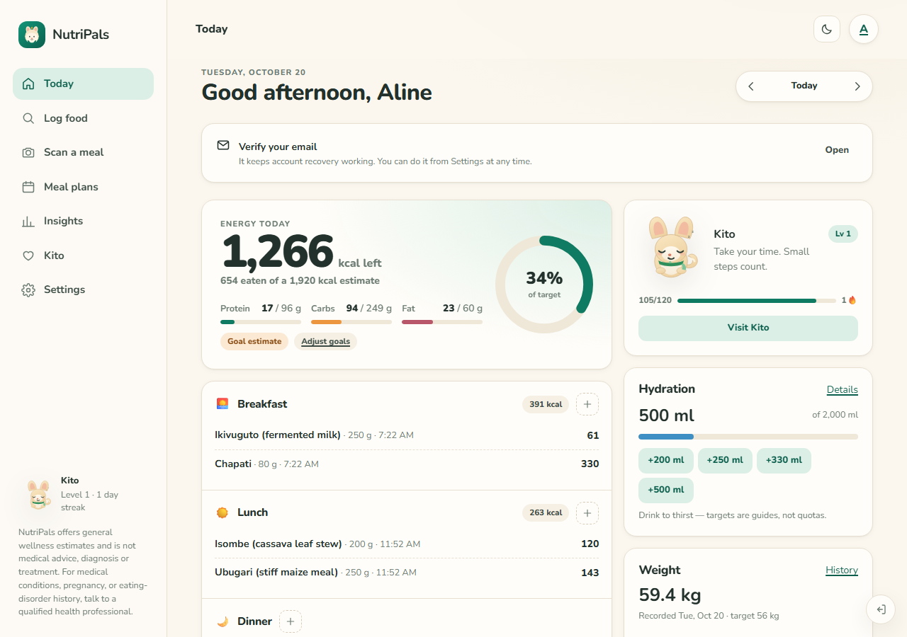
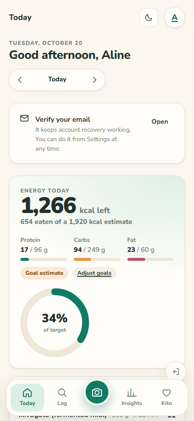
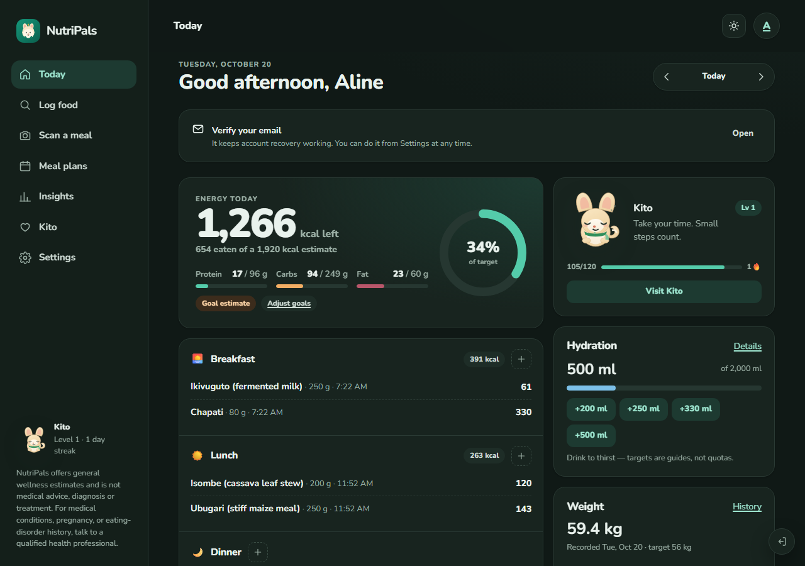
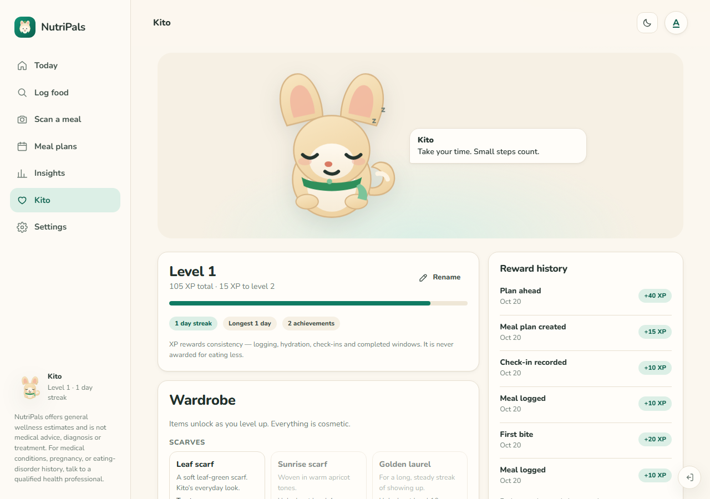
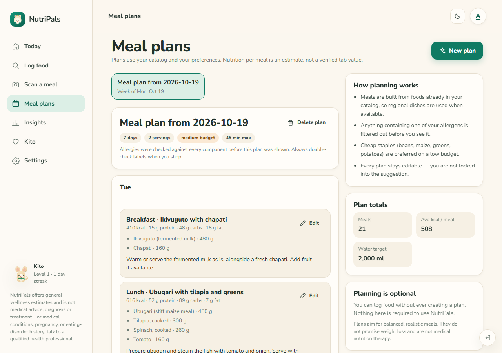

# NutriPals

An AI nutrition and habit companion: photograph a meal, review the estimate, and watch
your day, your water, your weight and your streaks come together — with a small forest fox
named Kito who cheers for consistency rather than restriction.

NutriPals is an original product inspired by the *category* of AI calorie trackers. It is not
affiliated with, and contains no assets from, any existing product.



| Phone | Dark mode |
| --- | --- |
|  |  |
|  |  |

---

## 1. What is implemented

**Accounts and onboarding**
- Email + password registration, scrypt-hashed passwords (`node:crypto`), opaque server-side sessions in httpOnly cookies.
- Email verification and password reset flows (token-based; see limitations for delivery).
- Four-step onboarding: basics → body and activity → goal → preferences (units, dietary
  preferences, allergies, fasting, companion name, timezone).
- Goal estimates from Mifflin–St Jeor with an activity factor, a capped deficit, an intake
  floor and age safeguards. Every assumption is shown in the UI, and the numbers are labelled
  estimates, not prescriptions.
- Metric/imperial switching that never mutates stored values, plus habit-only mode with no
  calorie target at all.

**Daily tracking**
- Dashboard with calories eaten/remaining, protein/carbs/fat, meals grouped by type,
  water, weight, streak and a "next useful action".
- Manual logging by search over a ~45-item catalog (with Kinyarwanda aliases), free-text
  parsing ("2 eggs and 150 g rice"), custom foods, barcode lookup, and portion editing.
- Meals are editable after the fact: items, grams, meal type, date and time.
- Day navigation with timezone-correct boundaries (the user's own timezone, not the server's).

**AI photo analysis (real integration, key required)**
- Camera capture or file upload, client-side downscale to 1280 px / ≤7.5 MB, MIME and size checks.
- Server-side adapter for OpenAI, Google Gemini or Anthropic (configurable; keys never reach
  the browser). Strict JSON schema validated with Zod, one repair retry, 45 s timeout.
- Multi-component meals: a plate of ubugari + beans + isombe comes back as separate editable
  items. When a catalog food matches confidently, catalog per-100 g values replace the model's
  numbers and the item is labelled as catalog-sourced.
- Review screen with confidence, portion uncertainty, naming, add/remove, gram editing;
  nothing is saved until the user confirms.
- Honest "not configured" state, per-user hourly rate limit, and the photo itself is never
  persisted — only the structured result.

**Habits**
- Hydration: target, quick adds, custom amounts, edit/delete, date history.
- Weight: entries with notes, history, trend chart, target, fully hideable.
- Fasting: 12:12 / 14:10 / 16:8 / custom, elapsed time derived from the stored start
  timestamp (so reloads and restarts are safe), finish/cancel, session history, disable switch.
- Activity: manual log with MET-based burn estimate kept separate from the food goal.
- Reminders: configurable meals/water/weight schedules, quiet hours, browser notifications.

**Companion**
- Kito is an original SVG fox with seven expressions and a wardrobe of unlockable cosmetics.
- XP, levels, streaks, achievements and a reward history, granted server-side by deterministic
  rules with unique event keys (the same meal can never earn XP twice).
- Every message is supportive and passes a safety filter; nothing is awarded for eating less.

**Insights and planning**
- 7/30/90-day statistics from stored rows only: logging days, meals per day, streaks,
  hydration-goal days, average calories/macros, weight trend, personal records.
- Charts with tooltips and a screen-reader data-table alternative.
- Deterministic weekly meal planner that respects dietary preferences and allergies, prefers
  regional ingredients, and produces instructions, nutrition estimates and a shopping list.
  Generated plans are editable and deletable.

**Platform**
- Responsive from 320 px to ultrawide: bottom tab bar on phones, persistent sidebar on
  desktop, single-column → two-column dashboard.
- Light / dark / system themes, reduced-motion support, focus-visible styles, keyboard
  navigation, labelled controls, 44 px touch targets.
- Installable PWA with an offline app shell and an "offline / reconnect" banner.
- Idempotency keys on every mutation, so retries and double taps cannot duplicate a meal.

---

## 2. Project structure

```
apps/
  server/                  Fastify API + SQLite (node:sqlite)
    src/
      routes/              auth, me, nutrition, habits, insights
      repo/                ownership-scoped SQL (meals, habits, users, insights)
      services/            ai.ts, foodSources.ts, planner.ts
      seed/                regional + common food catalog
      migrations/          numbered .sql files applied on boot
      app.test.ts          integration tests (app.inject, in-memory DB)
  web/                     React 19 + Vite SPA/PWA
    src/
      screens/             Welcome, Login, Register, Onboarding, Dashboard, LogFood,
                           Scan, MealEdit, Water, Weight, Fasting, Stats, Plans,
                           CompanionScreen, Settings, VerifyEmail, ResetPassword, NotFound
      components/          AppShell, Companion, charts, ui primitives, icons
      lib/                 api client wrapper, auth context, theme, format, image, notifications
      styles.css           design tokens + component styles
packages/
  core/                    shared domain logic, Zod schemas, types (no React, no DOM)
  api-client/              typed fetch client used by the web app
e2e/                       Playwright journeys + helpers
scripts/                   dev runner, screenshot generator
screenshots/               documentation images
ARCHITECTURE.md            deeper design notes and trade-offs
IMPLEMENTATION_PLAN.md     phase-by-phase acceptance checklist
TESTING.md                 what is tested and how to run it
```

## 3. Stack and architecture decisions

| Concern | Choice | Why |
| --- | --- | --- |
| Client | React 19 + Vite + React Router, TypeScript strict | Fast HMR, small bundles, one codebase for phone/tablet/desktop |
| Shared logic | `@nutripals/core` | Nutrition math, date boundaries, goals, rewards and schemas cannot drift between client and server |
| API | Fastify + Zod | Schema validation at the edge; typed contracts shared through `@nutripals/core` |
| Database | SQLite via `node:sqlite` (WAL) | Zero native build steps, real transactions and constraints; schema written for an easy Postgres move |
| Data access | Explicit SQL in `repo/*.ts` | Ownership rules stay visible and auditable; no ORM hiding `user_id` scope |
| Auth | scrypt (node:crypto) + opaque server sessions in httpOnly cookies | No token in JS, instant revocation, same-origin checks on mutations |
| AI | Provider adapter on the server | Swap OpenAI/Gemini/Anthropic by env var; keys never ship to the browser |
| Styling | Hand-written CSS with custom-property tokens | No runtime CSS-in-JS cost; one place to change palette, spacing, radii |

**Why a PWA rather than React Native/Expo.** The brief allowed either, and asked for a
polished responsive web experience. A single React/Vite build delivers sub-second navigation,
camera capture, notifications and installability on all four target sizes without shipping two
UIs. The trade-off is explicit: native-only integrations (Health Connect / Apple Health, App
Store billing) are not available, and the workspace could not build or test a native binary.
Everything the app claims to do works in the browser build that was actually exercised.

---

## 4. Environment variables

Copy `.env.example` to `.env` (loaded from the repo root or `apps/server`).

| Variable | Required | Purpose |
| --- | --- | --- |
| `PORT` | no (8787) | API port |
| `APP_ORIGIN` | yes in production | Web origin used for reset/verification links and cookie policy |
| `ALLOWED_ORIGINS` | recommended | Comma-separated origins allowed to make state-changing requests |
| `DATABASE_PATH` | no | SQLite file path (default `apps/server/data/nutripals.db`) |
| `SESSION_COOKIE_SECURE` | production | Set `true` behind HTTPS |
| `EXPOSE_DEV_TOKENS` | dev only | Returns verification/reset tokens in API responses. **Must be `false` in production** |
| `AI_PROVIDER` | for the scanner | `none` \| `openai` \| `gemini` \| `anthropic` |
| `OPENAI_API_KEY` / `OPENAI_BASE_URL` / `OPENAI_MODEL` | if `openai` | Vision model access |
| `GEMINI_API_KEY` / `GEMINI_MODEL` | if `gemini` | Vision model access |
| `ANTHROPIC_API_KEY` / `ANTHROPIC_MODEL` | if `anthropic` | Vision model access |
| `ENABLE_OPEN_FOOD_FACTS` / `OFF_USER_AGENT` | no | Packaged-food search and barcodes |
| `USDA_FDC_API_KEY` | no | Reference nutrition search |
| `RATE_LIMIT_MAX`, `AUTH_RATE_LIMIT_MAX`, `AI_RATE_LIMIT_MAX` | no | Abuse protection |

**Credentials you must supply for full functionality:** one AI provider key (otherwise the
scanner shows a documented "not configured" state with manual logging still fully usable), and
an email provider if you want real verification/reset mail (the server logs the link today).

No secrets belong in the repo. `EXPOSE_DEV_TOKENS=true` is a development convenience and
leaks tokens to any caller — turn it off before exposing the API.

---

## 5. Install, run, test, build

Requires Node ≥ 22.6 (uses `node:sqlite`).

```bash
npm install
cp .env.example .env          # then fill in what you have
npm run dev                   # API :8787 + web :5173 (watch mode)
```

Open http://localhost:5173.

```bash
npm run typecheck             # all workspaces, strict
npm run lint                  # eslint, zero warnings tolerated
npm test                      # 71 unit + integration tests (core, server, web)
npx playwright install chromium   # once, for the browser suite
npm run test:e2e              # 11 Playwright journeys (starts the app if needed)
npm run build                 # shared packages + web bundle + server tsc
npm start                     # serve the API from dist (set SERVE_WEB=true to serve the UI too)
```

`npm run seed` (re)seeds the food catalog into the configured database; the server also seeds
it on first boot, so this is only needed after wiping `apps/server/data/`.

---

## 6. Deployment

**Single-process deployment (simplest):**

```bash
npm ci
npm run build
SERVE_WEB=true WEB_DIST_PATH=../web/dist NODE_ENV=production \
  APP_ORIGIN=https://your-domain.example SESSION_COOKIE_SECURE=true \
  EXPOSE_DEV_TOKENS=false AI_PROVIDER=openai OPENAI_API_KEY=... \
  npm start
```

The server serves `/api/*` and, with `SERVE_WEB=true`, the built SPA with history fallback.
Put it behind Caddy/nginx for TLS, and persist `apps/server/data/` (the SQLite database)
on a volume. Back up by copying the database file (or `sqlite3 .backup`) on a schedule.

**Split deployment:** host `apps/web/dist` on any static host and set
`VITE_API_BASE_URL=https://api.your-domain.example` at build time; set `APP_ORIGIN` and
`ALLOWED_ORIGINS` on the API to the web origin. Cookies are `SameSite=Lax`, so cross-site
deployments need both origins on the same registrable domain or an explicit `SameSite=None`
change plus HTTPS.

**Migrations** run automatically at boot, in order, inside a transaction; `migrations/`
holds plain SQL you can review and run manually if you prefer.

**Before real users:** set `EXPOSE_DEV_TOKENS=false`, add a real email provider, choose a
password-reset link origin, set `SESSION_COOKIE_SECURE=true`, configure rate limits for your
traffic, and read the limitations below.

---

## 7. Tests actually executed

All results below are from this workspace, on Node 22.14 (Windows), against the real
Fastify app and a real SQLite database.

| Suite | Command | Result |
| --- | --- | --- |
| Core domain | `npm test -w @nutripals/core` | **31 passed** |
| Server integration | `npm test -w @nutripals/server` | **16 passed** |
| Web unit + component | `npm test -w @nutripals/web` | **24 passed** |
| Browser journeys | `npm run test:e2e` | **12 passed**, 1 opt-in AI test skipped |
| Photo-analysis journey | `E2E_AI_ENABLED=1 npx playwright test e2e/ai-scan.spec.ts` | **1 passed** against a local provider stub |
| Typecheck / lint / build | `npm run typecheck`, `npm run lint`, `npm run build` | all exit 0 |

The browser suite covers: registration through the real form → onboarding → dashboard with real
targets; a manually logged meal updating totals, surviving a reload, and being re-edited;
a forced network failure that keeps the tray, shows a friendly message and still creates exactly
one meal on retry; water and weight persistence; the fasting timer reading from its stored start
time after a reload; the companion gaining XP and an achievement from a real meal; sign-out and
sign-in preserving data; a second account getting 404 for another user's meal and an empty
export; the scan screen's honest "not configured" state; and no horizontal overflow on
375 / 820 / 1440 px across all nine app screens.

Manual browser verification (Chromium, live server) additionally covered: the "not configured"
AI state, a generated 7-day meal plan with regional dishes and instructions, the settings
surface (units, theme, tracking toggles, reminders, activity, export, deletion, password
change), dark theme tokens, and the phone bottom navigation.

Test detail and known gaps: [TESTING.md](TESTING.md).

---

## 8. What is not complete, and why

- **AI analysis has not been run against a live vendor model.** The full browser path was
  verified end-to-end against a local OpenAI-compatible test double (`scripts/ai-stub.mjs`):
  upload → server → provider HTTP call → schema validation → catalog matching → editable
  review → save with `source: "ai"`. What remains unverified is real model accuracy and cost;
  there was no API key in this environment. Adding one to `.env` and restarting is the only
  step required — expect real-world variance.
- **Email delivery is not wired to a provider.** Verification and reset tokens are generated,
  hashed at rest, expiring and single-use, but the "send" step logs the link. A provider
  (Resend/SES/Postmark) and a `mailer.ts` adapter are the remaining work.
- **Google / Apple sign-in not implemented.** Schema and UI hooks are absent rather than faked.
- **No native Android/iOS binaries.** No Health Connect, Apple Health, or store billing; the
  camera works through the browser file/capture input. Native builds would need Expo/RN or a
  Capacitor wrapper plus platform configuration.
- **Notifications only fire while a tab is open.** Scheduling uses the browser Notification
  API; dependable background reminders need a server-side scheduler and Web Push keys.
- **Subscriptions are not implemented.** No billing, no entitlement checks, nothing simulated.
- **SQLite, not Postgres.** Fine for a single-node deployment with a few thousand users;
  beyond that, move to Postgres and replace `repo/*.ts` queries. No database-level RLS exists —
  isolation is enforced in the data-access layer and tested per resource.
- **Meal-plan generation is rule-based, not model-based.** It respects allergies and budget
  from the catalog, which makes it deterministic and free, but less varied than an LLM planner.
- **Barcode lookup depends on Open Food Facts coverage**, which is uneven for local products.

---

## 9. Next improvements, in priority order

1. **Wire an email provider** and remove `EXPOSE_DEV_TOKENS` from the happy path — it is the
   only thing standing between this and real sign-up.
2. **Run the AI path against a live model**, capture 30–50 real photos, and tune the prompt and
   portion priors (especially for mixed East African plates). Log agreement rates so accuracy
   claims stay honest.
3. **Postgres + row-level security**, with the existing repos ported query by query, so
   isolation is enforced by the database and not only by code review.
4. **Background reminders**: a scheduler plus Web Push, so hydration and fasting nudges arrive
   when the app is closed.
5. **Photo-based meal history**: keep a downscaled thumbnail (with explicit consent and a
   retention window) so past meals are recognisable at a glance.
6. **Deeper insights**: protein-per-kg trends, weekday patterns, and "what changed" callouts
   that link a logged change to later entries without implying causation.
7. **Native shell** (Capacitor or Expo) for camera quality, Health Connect/Apple Health and
   store billing, reusing the same API and `@nutripals/core`.
8. **Accessibility and i18n pass**: Kinyarwanda and French UI strings, a screen-reader audit of
   the charts, and a full keyboard-only walkthrough.
